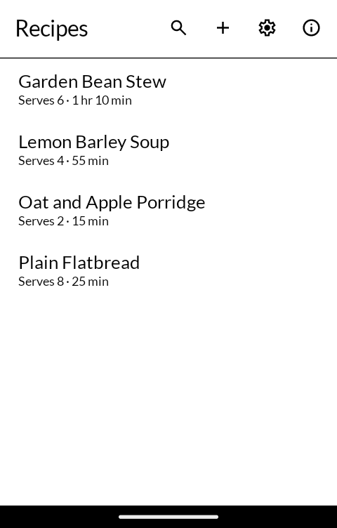
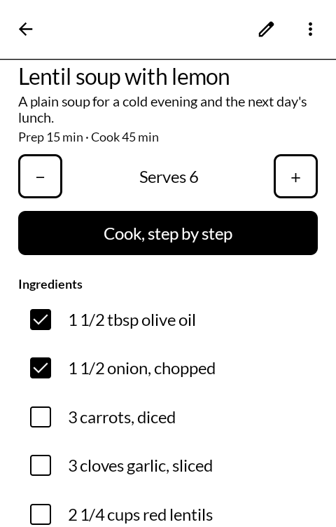
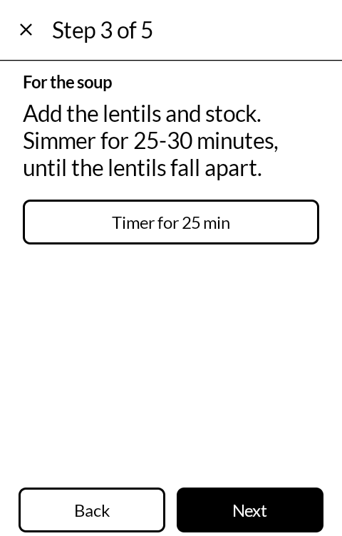
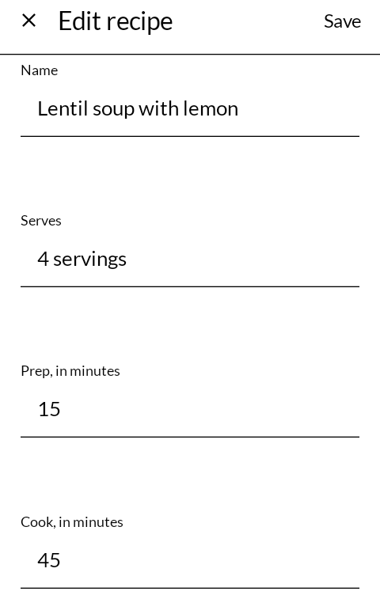

# 献立 kondate — Recipes

A recipe book for the [Mudita Kompakt](https://mudita.com/products/kompakt/): recipes saved from
the pages they were found on or typed in by hand, kept on the phone, and read one step at a time
at the stove. Built with Mudita's [MMD](https://github.com/mudita/MMD) design system. It installs
on any Android 12 device.

*Kondate* is 献立 — the menu, the plan of what is to be cooked.

| | |
|---|---|
|  |  |
|  |  |

## What it does

- **Saves a recipe from its page.** Share a recipe page to Recipes from the browser (or press +
  and paste its address) and it reads the recipe the page publishes for search engines — the
  name, how many it serves, the times, the ingredients, the method in its parts — and keeps the
  words. Not the pictures, not the life story above the recipe, not the adverts. Most recipe
  sites publish this; a page that does not opens the form with its name and address filled in,
  for the rest to be typed.
- **Typed in by hand**, as on a card: a name, how many it serves, the times in minutes, the
  ingredients one to a line, the method one step to a line. A line starting with `#` names a
  part of the method, such as `# For the sauce`.
- **Ingredients to tick off** as they go in the bowl. The ticks stay until they are cleared, so
  a recipe left halfway is still halfway when it is opened again.
- **Add to shopping list** sends the ingredients not yet ticked to
  [Notes](https://github.com/wanderwildwood/oboegaki) as a checklist, titled with the recipe. Without
  Notes on the phone, the list goes as plain text to whatever app you pick.
- **More or fewer servings.** The − and + beside "Serves 4" change every amount at the head of an
  ingredient line: 2 cups becomes 3, 1 1/2 tsp becomes 2 1/4, 400g becomes 600g. A line with no
  amount at its head ("salt to taste") is left as it is, and so is a size in the middle of a line
  ("1 tin (400 g)"). A recipe that does not say how many it serves scales by ×1/2, ×2 and so on.
- **Cook mode**: the method one step to a screen, in large type. Swipe sideways or press near
  either edge for the next step or the one before. The screen stays on while cook mode is open,
  and only then. Where a step names a time ("simmer for 25–30 minutes"), a button starts a timer
  for it in the clock app — [Clock](https://github.com/wanderwildwood/tokei) answers it, as does
  Android's own — and cooking carries on here.
- **Search** over names and ingredients: "lemon" finds every recipe with a lemon in it.
- **In and out of a file.** Settings saves every recipe to one file, and brings recipes in from
  one. A single recipe can be saved as a file or sent as text from its ⋮. A recipe file opened
  from Files, or shared from another app, is brought in.
- **Sync with your own Nextcloud**, if you sign in to one (Settings → Nextcloud). The recipes go
  in the folder [Nextcloud Cookbook](https://apps.nextcloud.com/apps/cookbook) keeps its own in,
  in its layout, so they show in Cookbook too, and a recipe added or changed there comes back
  here. It is off until you sign in, and the app works the same without it.

## Nextcloud

Signing in goes through Nextcloud's own login page in the browser, as its apps do, and the server
hands the phone an app password of its own, which can be revoked from the server's security
settings without touching your real one. A phone with no browser can take an app password typed
in instead. The folder starts as Cookbook's own (it asks Cookbook which), and can be changed.

The layout is Cookbook's: one folder per recipe, named after the recipe, holding `recipe.json`.
A recipe syncs when the app is opened, a few seconds after it is saved or deleted, and when you
press Sync now. Each side's changes since the last sync are followed:

- changed on one side: the other side takes the change;
- changed on both: both are kept — the server's under the recipe's name, the phone's as
  "… (phone)" beside it — unless the two now say the same thing;
- deleted on one side and not changed on the other: deleted on both. A change beats a deletion:
  a recipe deleted here but changed in Cookbook comes back, and the other way round;
- deleting on the phone deletes the recipe's `recipe.json`, and its folder only when nothing else
  is in it. A picture Cookbook downloaded beside the recipe is never deleted.

Which ingredients are ticked stays on the phone. Pictures are not synced either way.

## The file

Recipes are kept, and saved to a file, as [schema.org Recipe](https://schema.org/Recipe) JSON —
the same shape recipe pages publish them in, and the shape Nextcloud Cookbook keeps its recipes
in. Each is one small file in the app's own storage. An export is a JSON-LD document with every
recipe in its `@graph`; bringing it back replaces the recipes it holds and adds the rest. The one
field of the app's own is `notes`, since schema.org has nowhere for "less salt next time".

In Nextcloud the recipe is written the way Cookbook writes its own: the method as a flat list,
a part of it as a line `## For the sauce`, and the yield as a whole number. Three fields are the
app's own there: `notes`, `identifier` (the app's id for the recipe) and `recipeYieldText`, the
yield in words ("12 pancakes") beside Cookbook's number, read back only while that number has not
been changed in Cookbook. Cookbook leaves fields it does not know alone, and its editor keeps
them, so all three survive an edit there. Whatever Cookbook adds that this app does not show
(tools, nutrition) is kept when the phone writes the recipe back.

## What it does not do

- **No pictures.** A page's picture address is kept with the recipe, but nothing is downloaded
  or shown. On this screen a photograph of a stew is a grey shape, and the recipe is the words.
- **No account of its own.** The only sync is with a Nextcloud of your own, and only once you
  sign in to it.
- Times are found in English words ("10 minutes", "an hour and a half"). A recipe in another
  language reads and scales, but its steps offer no timer buttons.
- Scaling is arithmetic, not cooking: three eggs for half the servings comes out as 1 1/2.

## Privacy

Recipes goes online for two things. One is to fetch a recipe page whose address you shared with
it or typed in. That page is fetched once, as a phone's browser would ask for it, and nothing else
is sent — no pictures are fetched, no scripts run, nothing about you or your recipes goes with the
request. The site sees the request for its page, as it would from a browser.

The other is Nextcloud, and only when you have signed in to one: then your recipes go to your own
Nextcloud, and to nowhere else. Nothing goes there before you sign in, and after you sign out
nothing more does; the recipes already there stay until you delete them there.

Everything else stays on the phone, in the app's own storage: the recipes, which ingredients are
ticked, and, when you are signed in, the Nextcloud address, login name and the app password it
gave this phone. There are no accounts of the app's own, no analytics and no adverts. The app does not back itself up;
uninstalling it removes everything, so save your recipes to a file first if you want them.

A timer goes to the clock app and a shopping list to Notes only when you press for one. The
About dialog's last line opens a web address in your browser, and only when you press it.
[PRIVACY.md](PRIVACY.md) has the same, with the permissions.

## Building

```
./gradlew assembleDebug
```

A release build needs a keystore at `signing/signing.keystore` with a matching
`signing/signing.properties`. There is no fallback key in this repository: without one, a
release build comes out unsigned rather than wrongly signed.

`./gradlew testDebugUnitTest` runs the tests: the page reader against made-up pages in the
shapes recipe sites use (a WordPress `@graph`, a plain array, a block with stray line breaks,
microdata, a page with no recipe), a recipe written and read back, times read from ISO-8601 and
from the words of a step, and amounts scaled; and for Nextcloud, recipes read from and written to
Cookbook's `recipe.json` (made-up files in the shapes Cookbook leaves), folder names made by
Cookbook's rule, and two-way sync against a made-up server held in memory — new on either side,
edits on one side or both, deletions, a change against a deletion, renames, and a file changed
under a sync as it writes.

## Getting it, and keeping it

Download <https://github.com/wanderwildwood/kondate/releases/latest/download/kondate.apk>
and sideload it. That address always points at the newest release, and every release
publishes a `.sha256` beside the APK if you would rather check than trust.

For updates without doing this by hand, add this repository to
[Obtainium](https://github.com/ImranR98/Obtainium):

    https://github.com/wanderwildwood/kondate

## Licence

GPL-3.0-only. See [LICENSE](LICENSE).

Copyright (C) 2026 wander wildwood

This program is free software: you can redistribute it and/or modify it under the terms of the
GNU General Public License as published by the Free Software Foundation, version 3.

This program is distributed in the hope that it will be useful, but WITHOUT ANY WARRANTY;
without even the implied warranty of MERCHANTABILITY or FITNESS FOR A PARTICULAR PURPOSE. See
the GNU General Public License for more details.

You should have received a copy of the GNU General Public License along with this program. If
not, see <https://www.gnu.org/licenses/>.

Icons are from Material Symbols, Apache 2.0. The letters and page dots beside long lists are
adapted from inkOS by gezimos, GPL-3.0.
